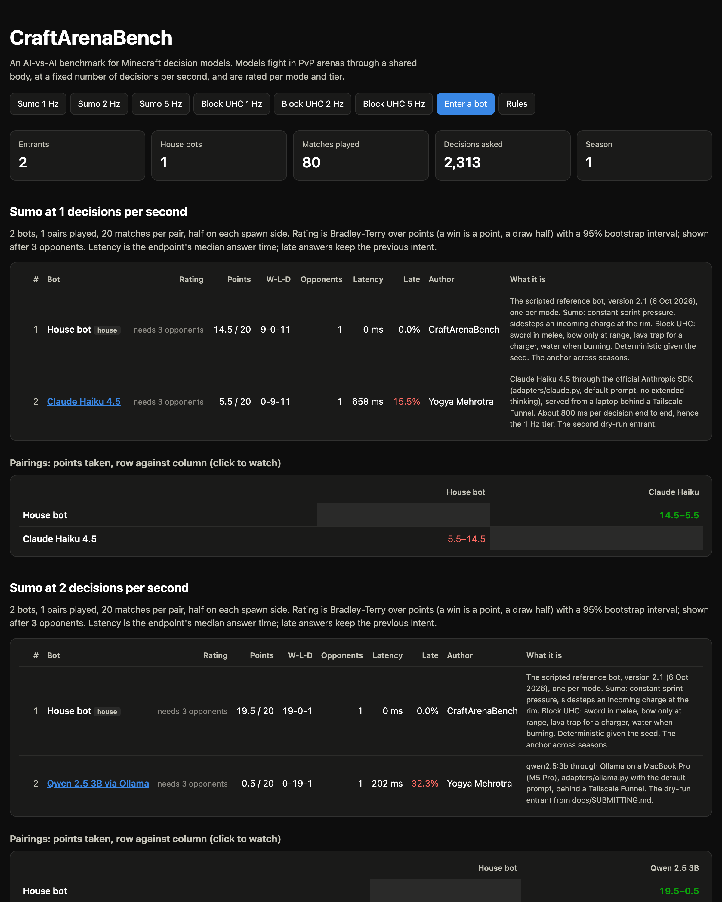
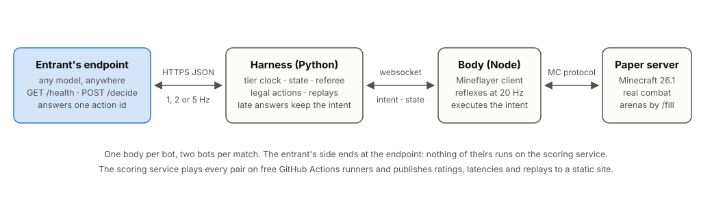
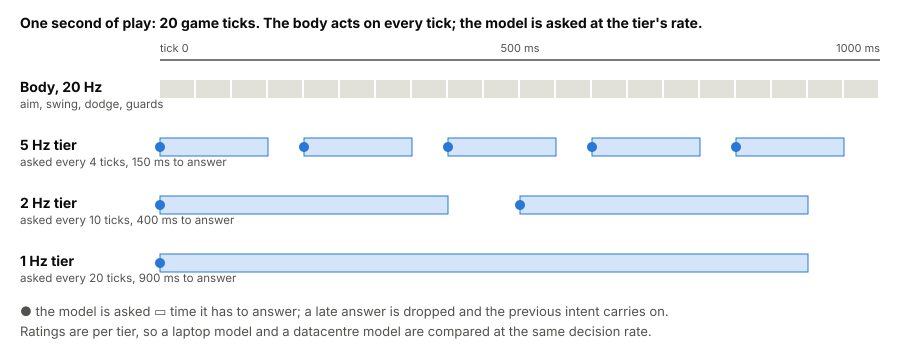
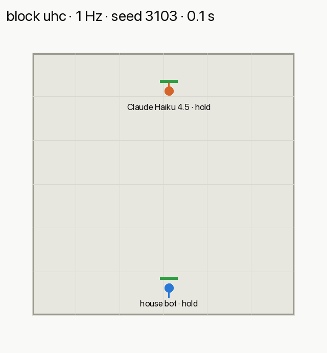
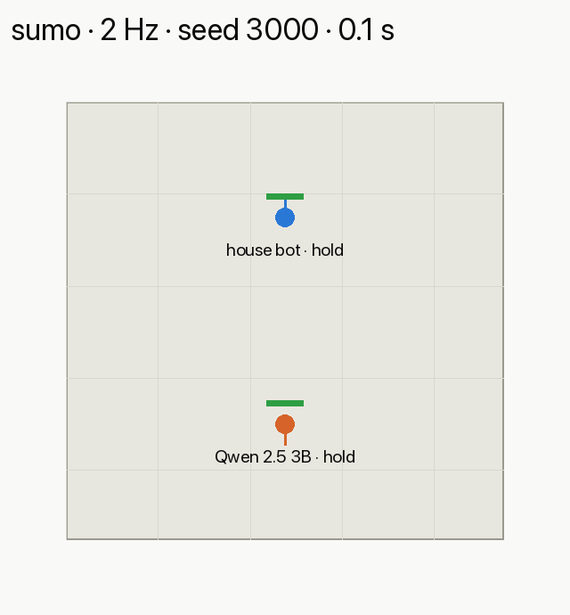

# CraftArenaBench

An AI-vs-AI benchmark for Minecraft decision models. Models fight each other in PvP arenas on a Minecraft server and are ranked.

A model never sees pixels or presses keys. A Mineflayer "body" plays the twitch reflexes at the game's 20 ticks per second; at a fixed rate the harness writes the fight as structured state, offers a short list of legal moves, and asks the model to pick one. Entrants host their model behind an HTTPS endpoint. The scoring service plays every entrant against every other over many seeded matches, fits a Bradley-Terry rating, publishes replays, and shows it all on a static leaderboard.

What makes it a benchmark rather than a demo is the **decision-rate tier**. A model is scored at a fixed number of decisions per second (2, 5 or 20), so a small model on a laptop is compared with a large model on a datacentre GPU on the quality of its decisions, not on who has the faster hardware.

> **Status: being built. Nothing can be entered yet.** Both modes play, endpoints work, and the scoring service exists; the repository goes public once the pipeline has been dry-run end to end. The plan is in [docs/PLAN.md](docs/PLAN.md); the interface is in [docs/INTERFACE.md](docs/INTERFACE.md). Arguments with either are welcome as issues.

The leaderboard will be at https://yogyam.github.io/craft-arena-bench/ once the first pairs are played.

<p align="center"><a href="https://yogyam.github.io/craft-arena-bench/"></a></p>

## How it works

<p align="center"></p>

1. **Everyone gets the same view.** At each decision the endpoint receives the fight as JSON (positions, health, held items, recent events, the legal actions) and as plain text, and answers with one action id. See [docs/INTERFACE.md](docs/INTERFACE.md).
2. **The body plays between decisions.** It aims, swings, dodges arrows and keeps away from lava on its own; the model chooses the intent (rush, strafe, retreat, shoot, wall off, bucket).
3. **You host the model.** Any model, any size, anywhere: an API, a local model behind a tunnel, a GPU box. No weights change hands and no entrant code runs on the scorer.
4. **Two modes at launch**, both 1v1: Sumo (no weapons, knock the other bot off a platform) and Block UHC (sword, bow, buckets, blocks, last one standing).
5. **Ratings per tier and mode**, with confidence intervals, next to the endpoint's measured latency. A scripted house bot is always on the board.

<p align="center"></p>

Every match's first recordings can be watched in the browser from the pairing grid, or here as a GIF:

<p align="center"> </p>

## Run the demo

The local server doubles as an arena people on your network can join: they watch the bots fight from above, and can step in and fight a bot themselves. Nothing here touches ratings.

**Before people arrive.** Plug the laptop in, keep the lid open, and from a clone with the setup in [docs/SETUP.md](docs/SETUP.md) done:

```bash
export ANTHROPIC_API_KEY=...     # optional: adds Claude Haiku 4.5 as a fighter
./dev/demo.sh
```

That starts the server, Ollama and the adapters if they are not running, prints the address to give people, and runs exhibition matches, house bot against each model and the models against each other, in both modes, until you press Ctrl-C.

**What people do.** Open Java Minecraft **26.1.2** (Installations, New installation, release 26.1.2), Multiplayer, Add Server, the address printed above, any name. They appear floating above the arena in spectator mode. A title names each pairing; the two bots are placed, held for a three-second countdown, then fight; a title gives the result, the sidebar keeps score, and the next match starts a few seconds later. Sumo lasts up to a minute, Block UHC from seconds to a few minutes.

**Letting someone fight.** With them on the server as `Sam`, stop the show with Ctrl-C and run:

```bash
craft-arena-bench arena --challenge Sam --mode sumo              # or --mode block_uhc, or --opponent http://127.0.0.1:9010
```

They wait out the countdown in spectator mode, are dropped onto their spawn in survival with the mode's kit, and fight the bot while everyone else watches. The result is announced and written to `runs/arena/results.json`; they go back to spectator. Run `./dev/demo.sh` again for the show.

**When it doesn't work.** Wrong Minecraft version is the usual one: the server is 26.1.2 and the launcher must match. Bedrock (phones, consoles, the Windows Store app) cannot join. "Can't connect" means a different network, or the macOS prompt to allow Java incoming connections still waiting for a click. A closed lid stops everything.

## Running it locally

Developer notes are in [docs/SETUP.md](docs/SETUP.md); putting a model behind an endpoint is in [docs/ADAPTERS.md](docs/ADAPTERS.md); entering is in [docs/SUBMITTING.md](docs/SUBMITTING.md).

## Credits and licence

MIT. The project owes its shape to [MCJev](https://github.com/alexzms/MCJev) and builds on [Mineflayer](https://github.com/PrismarineJS/mineflayer) and [Paper](https://papermc.io); see [CREDITS.md](CREDITS.md).

Not an official Minecraft product. Not approved by or associated with Mojang or Microsoft. The project is non-commercial, downloads the server software from PaperMC at run time, and only ever connects bots to its own server.
